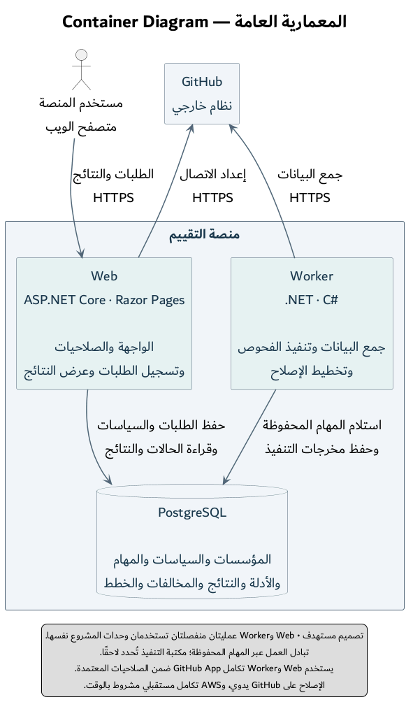

# المعمارية العامة — Container Diagram

التاريخ: 1 نوفمبر 2026. الحالة: تصميم مستهدف للمسار الأساسي للتقييم والتخطيط وإعادة التحقق.

[مصدر PlantUML](06-container-architecture.puml)

| العنصر | مسؤوليته |
|---|---|
| المتصفح | عرض الصفحات وإرسال طلبات المستخدم المخول واستعراض النتائج |
| Web | مصادقة المستخدم وفرض صلاحيات المؤسسة وإدارة الإعدادات وربط GitHub والتحقق منه، وقبول الطلب بعد حفظ المهمة، وعرض الحالة والأدلة والنتائج |
| Worker | استلام العمل المحفوظ وتنفيذ جمع GitHub والتقييم والتخطيط داخل حدوده، وحفظ مخرجاته وحالة محاولاته |
| PostgreSQL | حفظ بيانات المنصة والمهام ونسخ السياسات والأدلة والنتائج والخطط وتاريخ المخالفات |
| GitHub | المصدر الخارجي للبيانات المصرح بها، عبر GitHub App |

## قراءة التواصل

1. يرسل المتصفح الطلب إلى Web عبر HTTPS. يتحقق Web من التفويض والنطاق ويحفظ المهمة قبل تأكيد قبولها.
2. يستلم Worker المهمة المحفوظة وينفذها خارج عملية Web. يمثّل الرسم اعتماد التنفيذ على سجل العمل الدائم؛ مكتبة تشغيل المهام وآلية التقاطها التفصيلية لم تُختارا بعد.
3. يستدعي تكامل GitHub أثناء التنفيذ، ثم يستخدم مقيّم الإعدادات أو محرك التخطيط بحسب نوع المهمة. تفصيل الوحدات واستدعاءاتها يكون في Component Diagram.
4. تحفظ الأدلة والنتائج وحالات التنفيذ في قاعدة البيانات. يقرأ Web الحالة والمخرجات ويعرضها للمستخدم بعد فحص الصلاحيات.

الأسهم علاقات استخدام تقنية، ولا تعني أن قاعدة البيانات تدفع رسائل إلى Web أو Worker. اتصال قاعدة البيانات يستخدم Npgsql وEF Core بحسب الجزء المطلوب؛ لا يفرض الرسم تصميمًا لمكتبة الطوابير.

مسار [UC02 — إدارة اتصال GitHub](../../use-cases/UC02-github-connection.md) يستخدم التكامل من Web لإعداد الربط والتحقق منه، ويظهر له سهم مستقل إلى GitHub. يتنقل المستخدم إلى GitHub للتفويض والتثبيت ثم يعود إلى المنصة؛ خطوات المتصفح هذه مفصلة في Activity، وليست أسهم تسلسل في هذا المنظور العام. جمع أدلة التقييم ينفذ في Worker. عقد endpoints والصلاحيات التفصيلي سيحدد قبل برمجة التكامل.

## حدود القرار

- Modular Monolith هنا وحدات تطبيق مترابطة داخل قاعدة الشيفرة نفسها، مع نقطتي تشغيل Web وWorker. لا يفرض ذلك API شبكية داخلية بين الوحدات أو Microservices.
- فصل العمليتين يقلل انتقال بعض الأعطال إلى الواجهة، لكنه لا يعزل الجهاز أو قاعدة البيانات أو جميع موارد التشغيل. حدود الوقت والمحاولات والموارد ومعالجة الأخطاء تبقى مطلوبة.
- تفاصيل الاستضافة والنسخ الاحتياطي وتشغيل العمليات تُعرض لاحقًا في Deployment Diagram. كلمة Container في C4 لا تشترط Docker.
- اعتماد الفحوص الـ24 باقٍ، ومحرك التخطيط أضيق من نطاقها. النموذج المحلي لا يثبت تنفيذ هذه المعمارية.

المرجع: [نطاق المشروع](../../PROJECT_SCOPE.md)، و[UC02](../../use-cases/UC02-github-connection.md)، و[UC05](../../use-cases/UC05-run-assessment.md)، و[UC07](../../use-cases/UC07-request-repair.md)، و[UC08](../../use-cases/UC08-reverify.md).

حالة توثيق الاستخدام: الحالات العشر الحالية موصوفة تفصيليًا؛ أحدثها [UC01 — إدارة العضويات والأدوار](../../use-cases/UC01-manage-memberships.md). لا يعني ذلك اكتمال SRS أو مصفوفة الصلاحيات أو تفاصيل المصادقة أو بقية مناظير التصميم.
