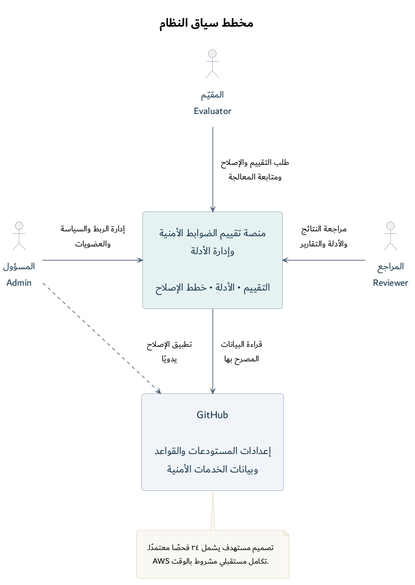

# مخطط سياق النظام — CTX-01

التاريخ: 1 نوفمبر 2026. الحالة: تصميم مستهدف مستند إلى النطاق المعتمد، وليس وصفًا لمنصة منفذة.

صيغة الرسم المعتمدة بناءً على طلب المستخدم: [ملف PlantUML](01-system-context.puml). المنصة في المنتصف وGitHub أسفلها؛ المقيّم أعلى المنصة، والمسؤول والمراجع على جانبيها.

المعاينة الحالية: [PNG من PlantUML](01-system-context.png). ملفات SVG وPNG وPDF الموجودة مباشرة في هذا المجلد تعود إلى التنسيق السابق، وتبقى مراجع محفوظة.

## الغرض وحدود الرسم

يوضح المخطط من يستخدم المنصة، وما تقدمه بوصفها نظامًا واحدًا، وعلاقتها الخارجية بـGitHub. يمثل منظور System Context في C4. مسؤوليات Web وWorker وقاعدة البيانات تظهر في المخططات التالية؛ لا تمثل الصناديق الحالية وحدات داخلية أو تسلسلًا زمنيًا للطلبات.

| العنصر | نوعه | المسؤولية الممثلة |
|---|---|---|
| المسؤول — Admin | دور مستخدم | يدير اتصال GitHub وسياسة المؤسسة والعضويات، ويطبق الإصلاح خارج المنصة يدويًا |
| المقيّم — Evaluator | دور مستخدم | يطلب التقييم وخطة الإصلاح ضمن صلاحياته، ويتابع معالجة المخالفات |
| المراجع — Reviewer | دور مستخدم | يراجع النتائج والأدلة والتقارير بصلاحية الاطلاع |
| منصة تقييم الضوابط الأمنية وإدارة الأدلة | النظام موضوع التصميم | تقيّم الفحوص المعتمدة وتحفظ الأدلة وتتابع المعالجة وإعادة التحقق وتقترح خططًا للحالات التي يدعمها المحرك |
| GitHub | نظام خارجي | مصدر قواعد الحماية والاستثناءات والإعدادات وبيانات الخدمات الأمنية المختارة، ومكان تطبيق المسؤول للتعديل |

الأدوار مرتبطة بعضوية المستخدم داخل المؤسسة؛ لا يفترض الرسم ثلاثة أشخاص محددين أو انتقال صلاحيات مستخدم بين المؤسسات. تفصل [مصفوفة الصلاحيات المعتمدة](../../ACCESS_CONTROL_MATRIX.md) كل إجراء؛ يشمل دور المسؤول التشغيل والاطلاع أيضًا، وتبرز علاقة السياق هنا مسؤولياته الإدارية.

## قراءة العلاقات

1. المسؤول يتعامل مع المنصة لإدارة الاتصال والسياسة ضمن صلاحيات مؤسسته.
2. المقيّم يطلب تشغيل التقييم والتخطيط ويتابع النتائج؛ الطلب لا يعني أن العمل ينفذ داخل استجابة HTTP نفسها.
3. المراجع يطّلع على الأدلة والتقارير. العلاقة تمثل الاستخدام والاطلاع، وليست تصريحًا بالتعديل.
4. علاقة المنصة مع GitHub قراءة مصرح بها للبيانات اللازمة للفحوص. استجابة GitHub ضمن هذه العلاقة مفهومة، ولا يعني اتجاه السهم أن البيانات ترسل إليه للحفظ. وسيلة الاعتماد المعتمدة GitHub App، وتفاصيل الصلاحيات في تصميم التكامل.
5. السهم المتقطع من المسؤول إلى GitHub يمثل تطبيقه اليدوي للإصلاح. بعد التطبيق يطلب المستخدم المخول تقييمًا جديدًا للتحقق؛ الخطة وحدها لا تثبت نجاح التغيير.

الفحوص الـ24 ضمن النطاق المعتمد وتسلّم تدريجيًا، وتبقى الفحوص الأمنية مرتبطة بتوافر خدماتها وصلاحياتها. محرك الإصلاح أضيق من نطاق الفحوص ولا يعد بإصلاح كل مخالفة. يظهر AWS كملاحظة مستقبلية دون اتصال حالي، وتفاصيله تحدد لاحقًا بعد إنجاز GitHub ومراجعة الوقت المتبقي.

## شرح شفهي مقترح

«هذه منصتنا ككل. المسؤول يربط نطاق GitHub المصرح به ويحدد سياسة المؤسسة، والمقيّم يشغّل التقييم ويتابع المخالفات ويطلب خطة إصلاح للحالات المدعومة، والمراجع يطّلع على الأدلة والتقارير. تجمع المنصة البيانات من GitHub وتحفظ نتائجها وأدلتها. عند وجود خطة إصلاح يطبقها المسؤول على GitHub يدويًا، ثم نعيد التقييم للتحقق. أما AWS فهو تكامل مستقبلي مشروط بالوقت.»

## مصادر التصميم

- [نطاق المشروع المعتمد](../../PROJECT_SCOPE.md).
- [حصر المتطلبات الوظيفية](../../FUNCTIONAL_REQUIREMENTS_INVENTORY.md)، ولا سيما العضويات والصلاحيات، والجمع والأدلة، والتخطيط وإعادة التحقق.
- [كتالوج الفحوص](../../CHECK_CATALOG.md).
- [مرجع System Context في C4](https://c4model.com/diagrams/system-context).

تعديل الرسم لا يغير نطاق المشروع أو يثبت تنفيذ التكامل. راجع تعريفات الصناديق والعلاقات عند تغيير المتطلبات، ثم أعد تصدير المعاينة من ملف PlantUML.
