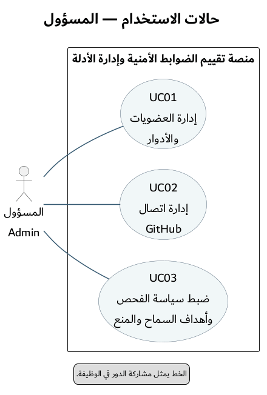
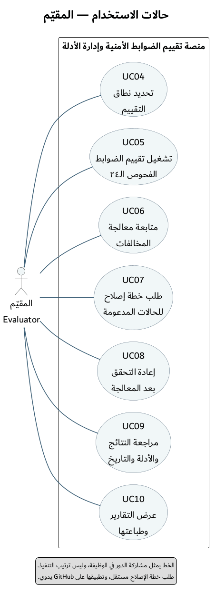
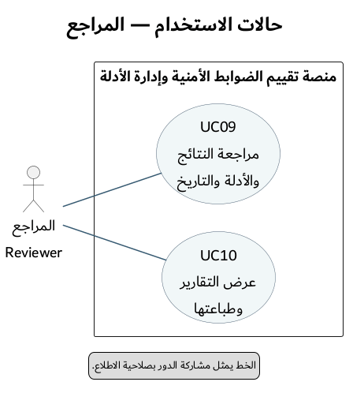

# حالات الاستخدام — UC-OVERVIEW

التاريخ: 1 نوفمبر 2026. الحالة: تصميم وظيفي عام، وليس وصفًا لتنفيذ قائم.

المصدر القابل للتعديل: [PlantUML](02-use-cases.puml).

## المسؤول

## المقيّم

## المراجع

هذه ثلاثة مناظر للمنصة نفسها، وليست ثلاثة أنظمة. تكرار UC09 وUC10 يوضح أن المقيّم والمراجع يستخدمان الوظائف نفسها. المستطيل يمثل حدود المنصة، والأشكال البيضاوية تمثل حالات الاستخدام. الخط العادي بين الدور والحالة يمثل المشاركة في الوظيفة، ولا يمثل ترتيبًا زمنيًا أو تدفق بيانات. تظهر معرفات UC داخل الأشكال لتطابق الوصف التفصيلي. تفصل المناظر الأدوار لتجنب تقاطع علاقاتها.

| الحالة | الوظيفة | مرجع المتطلبات |
|---|---|---|
| UC01 | إدارة العضويات والأدوار | FR-02، FR-03 |
| UC02 | إدارة اتصال GitHub وجاهزيته | FR-04 إلى FR-06 |
| UC03 | ضبط سياسة الفحص وأهداف الأطراف | FR-08، FR-18 |
| UC04 | تحديد نطاق التقييم | FR-07 |
| UC05 | تشغيل تقييم الضوابط | FR-09 إلى FR-13، FR-27، FR-28 |
| UC06 | متابعة معالجة المخالفات | FR-15، FR-16 |
| UC07 | طلب خطة إصلاح للحالات المدعومة | FR-19 إلى FR-22، FR-28 |
| UC08 | إعادة التحقق بعد المعالجة | FR-17 |
| UC09 | مراجعة النتائج والأدلة والتاريخ والمقارنة | FR-12، FR-14، FR-23، FR-24 |
| UC10 | عرض التقارير وطباعتها | FR-25 |

إدارة الوصول: [UC01 — إدارة العضويات والأدوار](../../use-cases/UC01-manage-memberships.md)، ومعه [Activity Diagram](../activity/13-manage-memberships-activity.puml).

إعداد المصدر: [UC02 — إدارة اتصال GitHub](../../use-cases/UC02-github-connection.md)، ومعه [Activity Diagram للربط والفصل](../activity/07-github-connection-activity.puml).

تحديد المطلوب: [UC03 — ضبط سياسة الفحص وأهداف الأطراف](../../use-cases/UC03-configure-policy.md)، ومعه [Activity Diagram](../activity/08-policy-and-objectives-activity.puml).

تحديد نطاق التشغيل: [UC04 — تحديد نطاق التقييم](../../use-cases/UC04-define-assessment-scope.md)، ومعه [Activity Diagram](../activity/09-assessment-scope-activity.puml).

تشغيل الفحوص: [UC05 — تشغيل التقييم](../../use-cases/UC05-run-assessment.md)، ومعه [Activity Diagram](../activity/03-run-assessment-activity.puml).

متابعة المعالجة: [UC06 — متابعة معالجة المخالفات](../../use-cases/UC06-follow-up-findings.md)، ومعه [Activity Diagram](../activity/10-finding-follow-up-activity.puml).

الوصف التفصيلي التالي: [UC07 — طلب خطة إصلاح](../../use-cases/UC07-request-repair.md)، ومعه [Activity Diagram](../activity/04-request-repair-activity.puml).

إغلاق دورة المعالجة: [UC08 — إعادة التحقق](../../use-cases/UC08-reverify.md)، ومعه [Activity Diagram](../activity/05-reverify-activity.puml).

المراجعة والمقارنة: [UC09 — مراجعة النتائج والأدلة والتاريخ](../../use-cases/UC09-review-results-evidence.md)، ومعه [Activity Diagram](../activity/11-review-results-activity.puml).

التقرير: [UC10 — عرض التقارير وطباعتها](../../use-cases/UC10-view-print-reports.md)، ومعه [Activity Diagram](../activity/12-view-print-reports-activity.puml).

جميع حالات الاستخدام تفترض تسجيل الدخول وعضوية صالحة وتفويضًا داخل المؤسسة؛ إدارة الجلسة وسجل التدقيق متطلبات مشتركة FR-01 وFR-03 وFR-26. المخطط يعرض توزيع المسؤوليات الرئيسي؛ لا يحسم وحده كل تفاصيل مصفوفة الصلاحيات أو يمنح المستخدم صلاحية على مؤسسة أخرى.

الفحوص الـ24 جزء من UC05، وتسلم تدريجيًا؛ تشغيل الفحوص الأمنية مشروط بتوافر خدماتها وصلاحياتها. حفظ الأدلة وتنفيذ المهمة الخلفية تفاصيل داخلية لحالات الاستخدام، ولا يصور الرسم أن المستخدم ينفذها يدويًا.

طلب خطة الإصلاح مستقل بعد التقييم، ولا تعني العلاقة السماح بالتطبيق الآلي على GitHub. يظهر التطبيق اليدوي الخارجي في [مخطط السياق](../context/01-system-context.md)، والمسارات الرئيسية موثقة في Activity للحالات UC01 إلى UC10. مخططات Sequence وعقد API التفصيلي لم تُعدّ بعد.

المرجع: [المتطلبات الوظيفية](../../FUNCTIONAL_REQUIREMENTS_INVENTORY.md) و[النطاق المعتمد](../../PROJECT_SCOPE.md).
